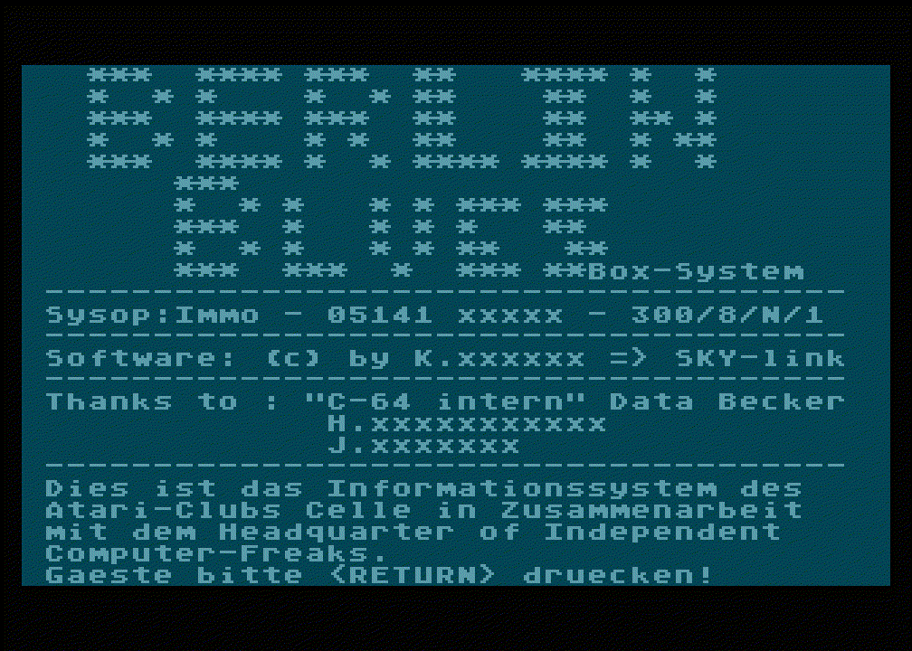
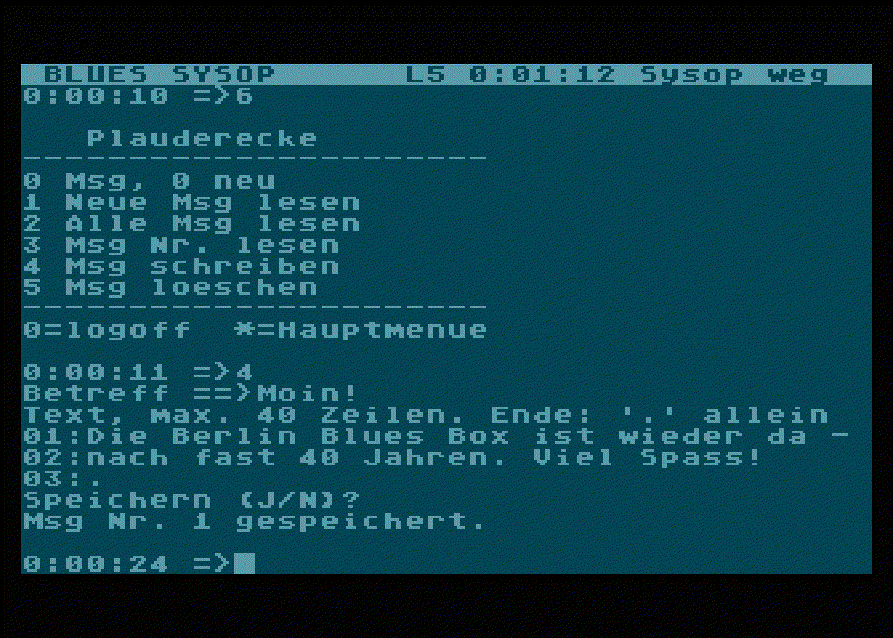

# Berlin Blues BBS

A revival of the **Berlin-Blues-Box**, the 1987 mailbox of the Atari-Club Celle, as a single-line BBS on an
**Atari XL with FujiNet**. Callers dial in via **telnet** (default port 6502) from a PC, Mac or phone, or from an
Atari 8-bit, C64 or Schneider CPC.

## The A.C.C. and the Berlin-Blues-Box

The **Atari-Club Celle (A.C.C.)** was a club of Atari 8-bit users (400/800/XL/XE) in Celle, Lower Saxony.
From 1987 to 1988 the club published **Pokey**, a disk magazine with six issues, released as public domain.

In 1987 the club ran its own mailbox: the **"BERLIN-Blues Box-System"**, "das Informationssystem des
Atari-Clubs Celle in Zusammenarbeit mit dem Headquarter of Independent Computer-Freaks" (HICoF). Sysop was
Immo, callers came in at 300 baud (8N1), the software was SKY-link. Pokey Nr. 5 printed a
complete session as a transcript – it is the template for the look, the login and the menus of this
revival.



*The 1987 login screen, from the session transcript in Pokey Nr. 5 – shown on an (emulated) Atari XL,
blank lines left out to fit 24 rows, surnames masked.*

Today's Berlin Blues BBS is the communication hub of our retro-computing meetup group: boards, personal
messages and a chat with the sysop, served by a real (or emulated) Atari.

## What you get



*Berlin Blues BBS today: the sysop console on the Atari (atari800 + FujiNet-PC) while SYSOP writes a message
from a telnet session. Status line on top: caller, level, time online, sysop away.*

- Login like 1987 ("Gaeste bitte <RETURN> druecken!"), guests, registration, new users need sysop approval
  before they can write
- Message boards and personal messages, menus from a text file
- Sysop console on the Atari: status line, chat with the caller, paging signal, local login
- Each caller gets their machine's character set: ASCII/telnet (PC, Mac, phone, CPC), ATASCII (Atari), PETSCII (C64)
- Program texts in English or German (more languages: one text file)
- Built for 24/7: timeouts against bots, survives dropped calls and FujiNet restarts, safe SD writes

## Setup a) Emulator (Linux PC)

Runs the Atari in **atari800** and the FujiNet in **FujiNet-PC** on a Linux box. This is how the BBS runs
online today.

1. **Toolchain:** cc65, fujinet-lib (Atari 5.1.0), atari800 (7.2.1, with NetSIO) and FujiNet-PC. The Makefile
   expects them in a sibling folder `../atari-dev` (cc65, fujinet-lib and atari800 under `../atari-dev/opt/`) and
   FujiNet-PC in `opt/fujinet-pc/` – that companion setup isn't published yet (other place: `make DEV=/path`).
2. **Atari OS ROM:** `atari800.cfg` uses `rom/ATARIXL.ROM`. Atari's ROMs are copyrighted and not in this repo –
   put your own dump there, or delete the `ROM_OS_BB01R2=` line in `atari800.cfg` to use the built-in AltirraOS.
3. **Language:** `echo 'BBS_LANG = de' > config.mk` for German (default: English).
4. **First start:**

   ```sh
   make reset PW=yourpassword   # fresh BBS data, sysop password for the first start
   make run                     # FujiNet-PC + atari800 window with the BBS = sysop console
   telnet localhost 6502        # in a second terminal: call your BBS
   ```

   Log in as `SYSOP` with your password. FujiNet-PC's web UI is at http://localhost:8000. `make stop` stops
   everything. `make run` always restarts FujiNet-PC and atari800 together – don't restart atari800 alone.
5. **Online:** forward TCP port 6502 on your router to the PC (fixed LAN address via DHCP reservation) and
   open it in the firewall (`sudo ufw allow 6502/tcp`). **Never forward port 8000** – FujiNet-PC's web UI has
   no login. Test from outside your LAN, e.g. a phone on mobile data.
6. **Backup:** `tools/backup.sh` saves the BBS data into `backup/`; run it hourly from cron:
   `0 * * * * /path/to/blues-bbs/tools/backup.sh`.

## Setup b) Real hardware

> **Not tested on real hardware yet.** Everything below follows from the FujiNet docs and the emulator
> setup; please report what works.

You need an **Atari 800XL/130XE** (64 KB) and a **FujiNet** with an SD card, connected to your WLAN.

1. **Build** the BBS on a PC (toolchain as in a), steps 1 and 3): `make` → `build/bbs.xex`.
2. **SD card:** copy `build/bbs.xex` to the card, and the folder `sd/bbs/` as `/bbs/` (menus, texts,
   `bbs.cfg`). Put the initial sysop password into `/bbs/sysop.txt` (one line) – the BBS deletes the file
   after the first start.
3. **Boot:** start the Atari with the FujiNet, select the SD card in the FujiNet config and boot `bbs.xex`.
   The Atari's screen and keyboard are the sysop console.
4. **Online:** forward TCP port 6502 on your router to the FujiNet's IP address (DHCP reservation).
   FujiNet's clock gives date and time.
5. **Backup:** take the SD card out now and then and copy `/bbs/`.

## Customizing

| What | Where | Note |
|------|-------|------|
| Port | `bbs/bbs.cfg`: `port = 6502` | read at boot; router forward and firewall must match; 8000 is refused |
| Welcome banner | `bbs/texts/banner.txt` | plain ASCII, max. 40 columns for Atari/C64 callers |
| Help and info texts | `bbs/texts/*.txt` | linked from the menus with type `T` |
| Menus and boards | `bbs/menus.txt` | one item per line: `<menu> <key> <type> <arg> <level> <label>` – see the comments in the file; read at boot |
| Program language | `lang/en.txt`, `lang/de.txt` | `make BBS_LANG=de`; new language: copy `en.txt` to `xx.txt`, translate, `make BBS_LANG=xx` |
| Sysop password | menu 8 → 4 after login | first start: `bbs/sysop.txt`, `make reset PW=…` (deletes all data!) |
| Users | menu 8 → 9 (sysop) | approve new users so they can write |

`bbs/` means `sd/bbs/` in the emulator setup and `/bbs/` on the FujiNet SD card. After editing a file on the SD
card, restart the BBS. Program texts must be plain ASCII (umlauts as ae/oe/ue/ss) – the callers' machines don't
agree on special characters.

### Sysop keys (on the Atari)

| Key | Does |
|-----|------|
| **A** | sysop present/away – callers can page you for a chat only when you're present |
| **C** | chat with the caller (when paged, or any time during a call), ESC ends it |
| **K** | kick the caller |
| **L** | local login on the Atari's own keyboard and screen |
| **Q** | shut down cleanly |

## More

- [`docs/TECHNICAL.md`](docs/TECHNICAL.md) – how it works: phases, FujiNet findings, data formats, the
  24/7 hardening, tests and make targets
- [`CLAUDE.md`](CLAUDE.md) – notes for working on the code
